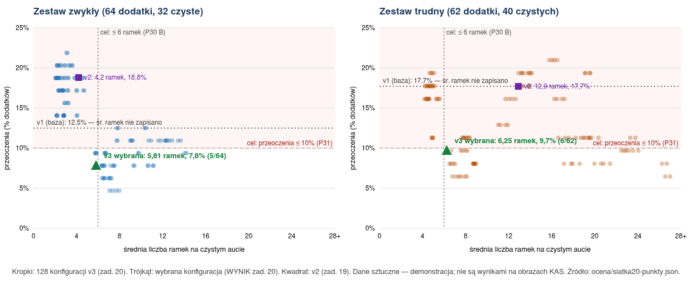

# Prześwit

> Prześwit to pomocnik operatora RTG: pokazuje, gdzie na obrazie auta patrzeć najpierw, a decyzja zawsze zostaje po stronie człowieka.

**Prześwit** to narzędzie AI dla operatora RTG na granicy: porównuje obraz naczepy z wzorcem typu pojazdu i zaznacza miejsca, w których może być ukryty towar. Operator zatwierdza lub odrzuca każde miejsce (odrzucenie z powodem); decyzja należy do niego. Na czystych autach program zwykle coś wskazuje — decyzję zawsze podejmuje człowiek.

Dla kogo: operatorzy RTG Służby Celno-Skarbowej (zadanie KAS, HackNation).
Makieta (wybór wariantu): https://pawelpisarek.github.io/hacknation-proba17/makieta/warianty/ · działający program: https://hacknation.ksefbot.pl/
Makieta R3 (klikalna, dane sztuczne, partia pokazowa 7 aut): https://pawelpisarek.github.io/hacknation-proba17/makieta/r3/

## Jak uruchomić

Wymaga Pythona 3 i `pip install -r requirements.txt`; liczy na karcie graficznej (CUDA), bez niej na procesorze (wolniej). Kod: `src/przeswit/` (`wykryj.py` — metoda bazowa v1, `wykryj2.py` — v2, `wykryj3.py` — v3, `bmp.py`), ocena: `ocena/ocena.py`, `ocena/wybor.py`, `ocena/analiza.py`.

```
# partia wskazanych obrazów (lista wyników + PNG z zaznaczeniami; opcjonalnie --typ firanka|chlodnia|kontener|cysterna)
PYTHONPATH=src python -m przeswit.wykryj --biblioteka KATALOG_WZORCOW --badane a.bmp b.bmp --wyj wyniki/partia
# szybka próba na małym zbiorze z repo + ocena
PYTHONPATH=src python -m przeswit.wykryj --biblioteka dane/mini --manifest dane/mini/manifest.json --wyj wyniki/mini
python ocena/ocena.py --manifest dane/mini/manifest.json --wyniki wyniki/mini/wyniki.json
```

**Uwaga:** domyślne ustawienia (`prog=6`) różnią się od użytych w wynikach, więc „szybka próba” da inne liczby. Wyniki odtwarzają skrypty na pełnych zbiorach (`$DANE`, `$TRUDNE`, karta graficzna): `ocena/uruchom.sh` (metoda bazowa; domyślna siatka `prog=6,10,14`, a `prog=10,14` tylko w kroku pelny2048; wynik bazowy to konfiguracja `dobor=najblizszy,K=3,tol=2,prog=14`), `ocena/uruchom19.sh` (metoda v2, `--metoda v2`), `ocena/uruchom20.sh` (v3). Uruchomienie strony i usługi lokalnie oraz wersja pokazowa: sekcja „Aplikacja” niżej.

## Aplikacja: strona + usługa na karcie (zadanie 21)

- **Pod linkiem:** https://hacknation.ksefbot.pl/ — strona (`strona/`, Node) przekazuje wgrany `.bmp` (do 120 MB) do usługi
  liczącej na karcie OMENa (`usluga/`, Python + torch). Przycisk „Partia pokazowa” liczy 7 aut z `dane/mini*`.
- **Jedna komenda (kontener zespołu):** `sh wdroz.sh` — usługa na karcie (orkiestrator, `gpu-tlo`), wdrożenie strony,
  sprawdzenie `/api/zdrowie` z linku. `sh wdroz.sh --usluga` budzi samą usługę (po 10 min bez pytań zwalnia kartę).
- **Lokalnie, bez internetu (jeden kontener na stanowisko):**
  ```
  docker build -f usluga/Dockerfile -t przeswit .
  docker run --rm --network none -p 8770:8770 przeswit        # strona i usługa: http://localhost:8770
  ```
  Z kartą NVIDIA: `--build-arg TORCH_INDEX=https://download.pytorch.org/whl/cu121` i `docker run --gpus all …`.
  Bez Dockera: `PYTHONPATH=src:. python -m usluga.serwer --bez-sieci` (usługa liczenia, http://127.0.0.1:8770).
- **Strona + usługa osobno (sprawdzone przez Programistę, 20.11.2026):**
  1. Usługa (karta NVIDIA, Python 3, `pip install -r requirements.txt`):
     `PYTHONPATH=src:. python -m usluga.serwer --host 127.0.0.1 --port 8770 --bezczynnosc 0` — sprawdzenie: `curl http://127.0.0.1:8770/zdrowie` → `{"ok": true, …}`.
  2. Strona (Node 22): `cp mvp/widok-auta/widok.js strona/public/ && PORT=3000 OMEN_URL=http://127.0.0.1:8770 node strona/serwer.mjs` → http://localhost:3000/ (albo Docker: `docker build -t przeswit . && docker run -p 3000:3000 -e OMEN_URL=http://<adres usługi>:8770 przeswit`).
  3. Testy: `node --test strona/testy/serwer.test.mjs strona/testy/budzik.test.mjs` (17/17); odbiór kliknięciami: `sh strona/testy/odbior-44-klik.sh http://localhost:3000`.
  Uwaga: sama usługa pod :8770 też podaje stronę, ale bez `widok.js` — widok auta nie działa; używać strony z punktu 2.
- **Wersja pokazowa** (ta sama co pod linkiem po ostatnim wdrożeniu) = znacznik git `final`: `git checkout final`, potem uruchomienie jak wyżej.

## Co dalej

- Plan: zapisane powody odrzuceń jako materiał do douczania metody (jeszcze nie zrobione).
- Wzorce z prawdziwych danych KAS i pomiary na obrazach KAS; integracja z systemami KAS; pomiar skalowania na kilku kartach.

## Strona na żywo — co działa

https://hacknation.ksefbot.pl/ (odebrane na linku, 20.11.2026, dane sztuczne):

1. Na obrazie auta widać ramki z numerami takimi samymi jak na kafelkach miejsc.
2. Kafelki są ułożone od miejsca najbardziej odmiennego od wzorca.
3. Lupa powiększa wybrane miejsce do 4×, a ramka zostaje na środku okna.
4. Obok obrazu badanego stoi wzorzec, z przesunięciem dopasowanym do miejsca.
5. Przy każdym miejscu jest podpowiedź „zwykle tu…” (np. podwozie — belki, koła i oś) — bez słów niski/średni/wysoki i bez procentów.
6. Cysterna nie ma wzorca: lista partii i raport piszą „brak wzorca — obejrzyj ręcznie”, ekran auta „sprawdź obraz sam”; ramek nie ma.
7. Własny obraz .bmp można wgrać ze strony; analiza trwała ok. 1,3 s (kontener, 12 miejsc).

8. Partia pokazowa ma 7 aut z liczbą miejsc 8 / 6 / 12 / 8 / 7 / 0 / 11; auto 6 (cysterna) ma „brak wzorca”.
9. Każde miejsce zatwierdzasz jednym kliknięciem albo odrzucasz z powodem wybranym z listy; auto zamykasz po wpisaniu numeru rejestracyjnego.
10. Raport partii pobierzesz jako .json i .csv; przy zamykaniu partii program ostrzega o autach bez decyzji.
11. Partia liczy się auto po aucie (stan „liczy się 3/7”), a na liście są miniatury obrazów; wiersze stają się klikalne, gdy auto jest policzone.
12. „Dodaj jeden obraz” dokłada kolejne auto do partii.
13. Gdy miejsc jest więcej niż widać, lista ma „i jeszcze N miejsc — pokaż” (z poprawną odmianą: 2 miejsca, 1 miejsce).
14. „Zamknij auto” działa po rozstrzygnięciu ostatniego miejsca (Enter jako skrót) i otwiera następne auto; po ostatnim wraca lista z „Raport partii”.
15. Po zamknięciu partii decyzji nie da się już zmienić (wiersze listy są zablokowane).
16. Rodzaj pojazdu zmienisz jednym kliknięciem, z podglądem 2 wzorców; auto przelicza się, a wcześniejsze decyzje przy nim są kasowane.
17. Po zmianie na cysternę program pisze „brak wzorca”.
18. Raport partii zawiera rodzaj wykryty przez program i rodzaj wybrany przez operatora.
19. W raporcie partii przy każdym aucie jest miniatura z zaznaczonymi miejscami; cysterna ma napis „brak wzorca”. Zapis daje trzeci plik, `raport-partii.html`, który otwiera się bez internetu.

Gdy program jest zajęty, strona pokazuje „Uruchamiam program, ok. 30 s” i sama ponawia liczenie. Uśpiony program obsługa budzi ręcznie przed pokazem (UPROSZCZENIE P86).

## Ograniczenia i przyjęte uproszczenia

- Wysłanie obrazu ok. 50 MB na stronę trwa ok. 45 s (samo liczenie ok. 1,5 s), a program liczy jeden obraz naraz.
- Wybór funkcjonariusza z listy zamiast logowania, bez integracji z systemami KAS (P87).
- Wzorce dla 3 rodzajów pojazdów; cysterna nie ma wzorca (P88).
- Raport partii jako plik (.json, .csv, .html z miniaturami), bez wysyłki i bez ekranu kierownika (P89).

## Wyniki (na danych sztucznych, nie na zdjęciach KAS)

Metoda pod linkiem to **v3** (zad. 20, WYNIK z 13:39 w `docs/decyzje.md`), zestaw zwykły / trudny:
- przeoczenia: **5/64 (7,8%)** / **6/62 (9,7%)**; cel ≤ 10% — **spełniony** na obu;
- ramki na czystym aucie: śr. **5,8** / **6,25**; cel ≤ 6 — zwykły spełniony, trudny minimalnie powyżej (brak 0,25 ramki);
- fałszywe alarmy (czyste auta z ≥ 1 ramką): **32/32** i **40/40** — dlatego lista pokazuje najwyżej 6 miejsc i „pokaż resztę”, a decyzję zawsze podejmuje człowiek;
- dobór wzorca: **64/64** i **80/80**;
- czas na obraz 50 MB (sam program): śr. **1,73 s** / **1,19 s**; wysłanie takiego pliku przez łącze na stronę trwa ok. 45 s (patrz „Ograniczenia”).

**Czym jest u nas fałszywy alarm.** Fałszywy alarm to czyste auto, na którym program zaznaczył ≥ 1 miejsce. Prześwit nie odpowiada „alarm: tak/nie” — daje operatorowi **kolejność miejsc** (najbardziej odmienne od wzorca pierwsze, na ekranie najwyżej 6), bo najważniejsze jest nie przeoczyć. Dlatego miarą jest średnia liczba ramek na czystym aucie (5,8 / 6,25), a nie „100% fałszywych alarmów” bez kontekstu; na 28 czystych autach (sonda 38 w `docs/odbior.md`) program zawsze wskazał ≥ 2 miejsca, więc „brak wskazań” nie jest obietnicą produktu. Decyzję o każdym miejscu podejmuje człowiek.



Wykres pokazuje, że wybrana konfiguracja v3 (zielony trójkąt) schodzi poniżej celu 10% przeoczeń przy ok. 6 ramkach na czystym aucie — v1 i v2 (kwadrat) mają więcej przeoczeń albo znacznie więcej ramek.

| Metoda | Przeoczenia zwykły / trudny | Ramki na czystym (śr.) | Fałszywe alarmy | Dobór wzorca |
|---|---|---|---|---|
| v1 (baza, zad. 2) | 8/64 (12,5%) / 11/62 (17,7%) | — | 32/32 / 36/40 | 64/64 / 79/80 |
| v2 (zad. 19) | 12/64 (18,8%) / 11/62 (17,7%) | 4,2 / 12,9 | 24/32 / 38/40 | 64/64 / 80/80 |
| **v3 (zad. 20, pod linkiem)** | **5/64 (7,8%) / 6/62 (9,7%)** | **5,8 / 6,25** | 32/32 / 40/40 | 64/64 / 80/80 |

Czas na obraz 50 MB mierzymy tylko dla v3 (śr. 1,73 s / 1,19 s); czasy v1 i v2 pochodzą z innych pomiarów (m.in. cała siatka konfiguracji naraz) i nie są z nimi porównywalne, więc ich nie podajemy. To wyniki wewnętrzne zespołu na obrazach sztucznych, nie gwarancja skuteczności na zdjęciach KAS.

## Co nowego

1. **Samodzielny dobór wzorca rodzaju pojazdu** — program sam wybiera wzorzec (dobór 64/64 i 80/80; WYNIK zad. 20); operator może zmienić rodzaj jednym kliknięciem (zrzut: `docs/zrzuty/mvp/link-27-zmiana.png`).
2. **Porównanie z dwoma najbliższymi wzorcami po wyrównaniu** — obraz badany stoi obok wzorca, z przesunięciem dopasowanym do miejsca (przeoczenia 7,8% / 9,7%, WYNIK zad. 20; zrzut: `docs/zrzuty/mvp/link-auto7-lupa4-miejsce2.png`).
3. **Ramka + „zwykle tu…” zamiast surowej mapy** — ramki ponumerowane jak kafelki, kolejność od najbardziej odmiennego, śr. 5,8 / 6,25 ramki na czystym aucie (WYNIK zad. 20; zrzut: `docs/zrzuty/mvp/link-auto7-ramki.png`).
4. **Decyzja operatora z powodem odrzucenia w raporcie** — .json, .csv i .html z miniaturami aut; powody zapisują się w raporcie (zrzut: `docs/zrzuty/mvp/link-43-raport.png`).
5. **Działanie lokalne, bez internetu** — kontener bez sieci liczy partię pokazową 7/7 (WYNIK zad. 21).
6. **Zbudowane przez zespół 5 botów AI** (OpenMausBot + Claude) w 24 h (dowód: [dziennik decyzji](https://github.com/PawelPisarek/hacknation-proba17/blob/main/docs/decyzje.md)); czas liczenia obrazu 50 MB śr. 1,73 s / 1,19 s (WYNIK zad. 20).

## Skalowanie

Pomiary: GTX 1050 (laptop OMEN), jeden obraz naraz. Reszta to wyliczenia i założenia z tych pomiarów — każde podpisane.

| Wielkość | Wartość | Źródło / założenie |
|---|---|---|
| Czas liczenia obrazu 50 MB | śr. 1,73 s (zwykły) / 1,19 s (trudny) | pomiar, WYNIK zad. 20 |
| Auta na godzinę na 1 kartę — samo liczenie | ok. 2 080 / ok. 3 020 | wyliczenie 3600 s ÷ 1,73 s i ÷ 1,19 s, **bez wczytania pliku** (górna granica) |
| Auta na godzinę przez stronę | rząd wielkości ok. 70 na jedno stanowisko — **nie wynik** | wysyłka 44,9 / 45,1 s (pomiar 8768b32); całe żądanie ~52 s to **jeden pomiar (n=1)** z innego przebiegu (WYNIK zad. 21); 3600 ÷ 52 |
| Więcej kart / stanowisk | przepustowość rośnie mniej więcej liniowo z liczbą kart | **założenie, niemierzone**: obrazy są niezależne |
| Nowy rodzaj pojazdu | dołożenie wzorców do biblioteki, bez trenowania | **założenie, niemierzone**: metoda porównuje z biblioteką (v3); próg doboru mógłby wymagać strojenia |
| Wąskie gardło | wysyłka pliku przez sieć (45 s z ~52 s) | pomiar j.w.; że przy liczeniu obok skanera znika — **założenie, niemierzone** |

## Dane

Zbiór sztuczny (zdjęć KAS nie mamy): naczepy czyste i z dodatkowym ładunkiem, pliki BMP do ~50 MB, cztery typy pojazdów. Opis i generator: `dane/README.md`; podzbiory w repo: `dane/mini/`, `dane/mini-trudny/`; pełne zbiory poza repo.

## Użyte narzędzia (przygotowane wcześniej)

- **Zespół botów na OpenMausBot** (5 ról: Szef, Projektant, Analityk, Programista, Prezenter) — https://github.com/milind-soni/OpenMausBot (Apache-2.0); zlecenia liczeniowe idą przez orkiestrator zadań (Slurm)
- **Orkiestrator zadań** (Slurm, klient `orkiestrator`) — kolejka zleceń liczeniowych na karcie
- **Karta graficzna** GTX 1050 (laptop OMEN), na której liczono wyniki
- **Modele Claude** (Anthropic)
- **Skille pm-skills** — https://github.com/phuryn/pm-skills (MIT); łańcuch opisu produktu w `docs/pm/`
- **Biblioteki z `requirements.txt`:** numpy, torch, pillow

## Dokumenty

`docs/hacktribe.md` (opis do formularza) · `docs/demo.md` (scenariusz pokazu) · `docs/slajdy.pdf` (źródło: `docs/slajdy-szkic.md`) · `docs/decyzje.md` (ustalenia i WYNIK) · `docs/materialy.md` · `docs/pm/` (łańcuch PM) · `docs/zrzuty/` (zrzuty, lupa)
