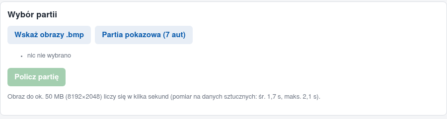
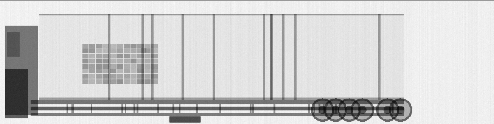
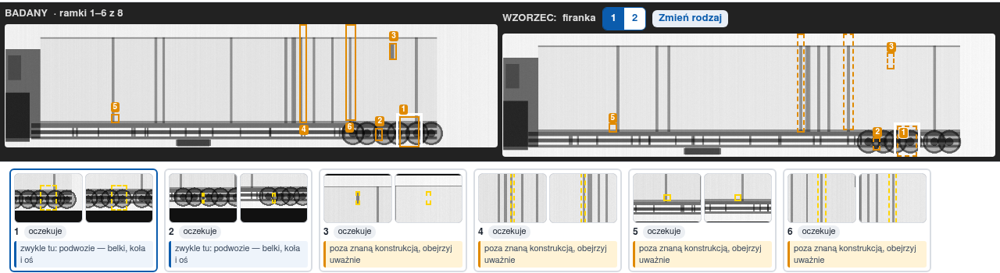
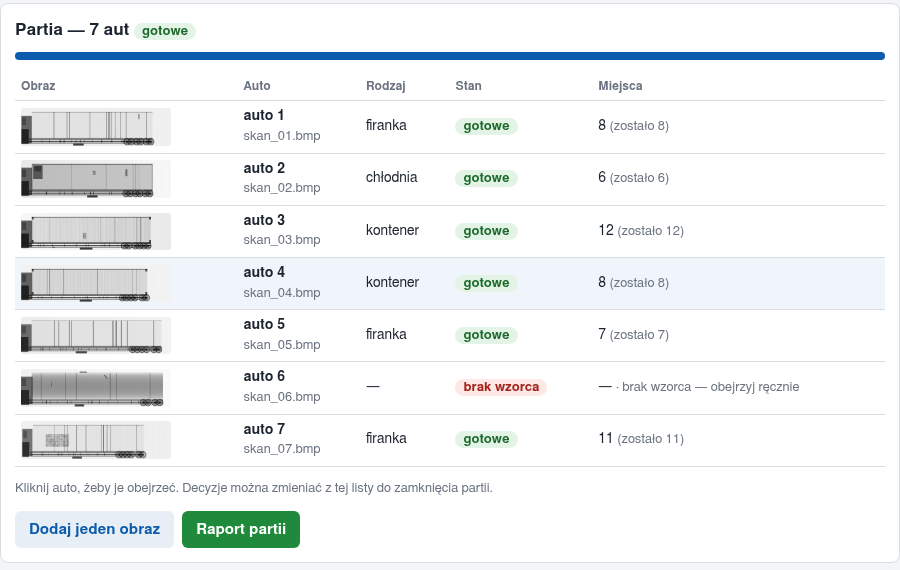
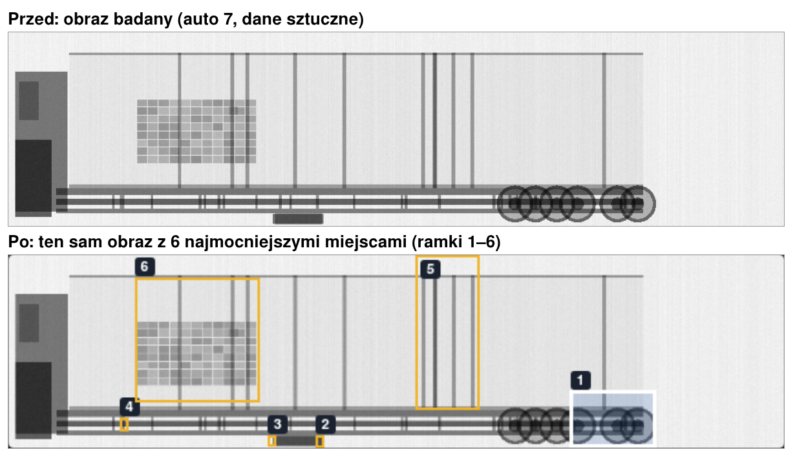
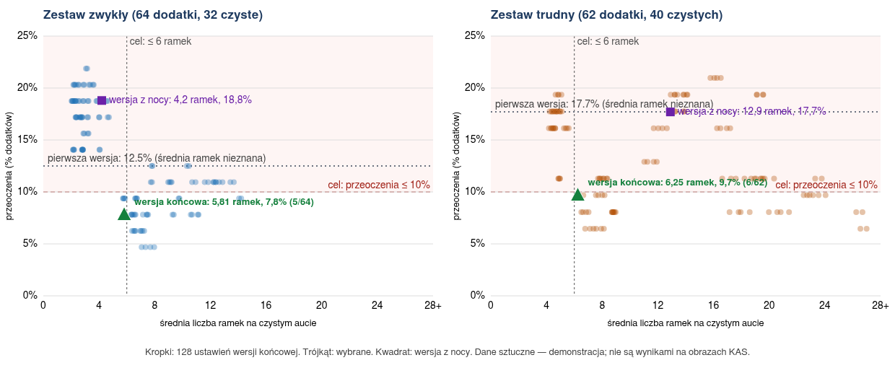
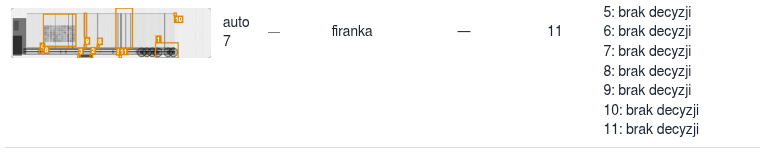

# Slajdy — Prześwit (10 slajdów; PDF: docs/slajdy.pdf)

> Oś przekazu (`value-prop-statements`): *Dla operatora RTG na granicy: Prześwit wskazuje miejsca, w których obraz naczepy odbiega od wzorca, więc operator w kilka minut wie, gdzie szukać skrytki — decyzję nadal podejmuje on.*
> Wszystkie liczby: dane sztuczne; źródło: linie WYNIK w `docs/decyzje.md`. Zrzuty z działającego programu (hacknation.ksefbot.pl), nie z makiety.

## 1. Prześwit
- Prześwit to pomocnik operatora RTG: pokazuje, gdzie na obrazie auta patrzeć najpierw, a decyzja zawsze zostaje po stronie człowieka.
- Narzędzie AI dla operatora RTG: porównuje obraz naczepy z wzorcem i zaznacza różnice.
- Zespół: Hackathon · repo: github.com/PawelPisarek/hacknation-proba17
- Działający program: hacknation.ksefbot.pl · makieta: pawelpisarek.github.io/hacknation-proba17/makieta/r3/
- Wszystko na danych sztucznych — demonstracja.
- 

## 2. Problem i dla kogo
- Operator RTG Służby Celno-Skarbowej ogląda obrazy naczep (Nuctech, Multicontrol; .bmp, ~50 MB) i na jedno auto ma kilka minut.
- Małe przeróbki konstrukcji łatwo przeoczyć; obecne narzędzie KAS wykrywa papierosy, słabo radzi sobie z małymi ilościami w konstrukcji.
- 

## 3. Rozwiązanie — operator decyduje
- Program dobiera wzorzec rodzaju pojazdu i pokazuje obraz badany obok wzorca, z ponumerowanymi miejscami od najbardziej odmiennego.
- Operator zatwierdza albo odrzuca każde miejsce (powód przy odrzuceniu); decyzje trafiają do raportu zapisywanego lokalnie.
- Gdy nie ma wzorca: „brak wzorca — obejrzyj ręcznie”. Na czystych autach program zwykle coś wskazuje — decyzję zawsze podejmuje człowiek.
- 

## 4. Demo (≈ 2 min, nagranie na hacknation.ksefbot.pl)
- Partia 7 aut: miejsc 8, 6, 12, 8, 7, 0 (brak wzorca — obejrzyj ręcznie), 11.
- Partia 7 aut liczy się na działającej usłudze w ok. 4 s — nagranie bez cięć.
- Auto 1: obraz i wzorzec obok siebie, 2 miejsca rozstrzygnięte; raport partii z miniaturami aut.
- Źródło: scenariusz docs/demo.md.
- 

## 5. Wyniki: jedno auto przed i po
- Przed: obraz bez ramek. Po: ten sam obraz z 6 najmocniejszymi miejscami (auto 7, 11 miejsc).
| Na danych sztucznych | zwykły | trudny |
| Przeoczenia | 7,8% (5/64) | 9,7% (6/62) |
| Dobór wzorca | 64/64 | 80/80 |
- Źródło: wyniki zespołu na danych sztucznych; nie są to obrazy KAS.
- 

## 6. Skuteczność: przeoczenia kontra ramki
- Miarą jest kolejność miejsc, nie alarm tak/nie: czyste auto dostaje śr. 5,8 / 6,25 ramki (fałszywy alarm = czyste auto z ≥ 1 ramką: 32/32, 40/40).
- Każda kropka to jedno ustawienie programu; zielony trójkąt (wersja końcowa) spełnia cel ≤ 10% przeoczeń, a „ramki na czystym aucie” to miejsca wskazane na aucie bez dodatku.
- Źródło: 128 ustawień wersji końcowej, dane sztuczne.
- 

## 7. Co nowego
- Samodzielny dobór wzorca rodzaju pojazdu: 64/64 i 80/80.
- Porównanie z dwoma najbliższymi wzorcami po wyrównaniu: przeoczenia 7,8% / 9,7%.
- Ramka + „zwykle tu…” zamiast surowej mapy: śr. 5,8 / 6,25 ramki na czystym aucie.
- Decyzja z powodem odrzucenia w raporcie (.json, .csv, .html z miniaturami).
- Działa lokalnie, bez internetu: partia pokazowa 7/7 w kontenerze bez sieci.
- Zbudowane przez zespół 5 botów AI w 24 h (dowód: dziennik decyzji, github.com/PawelPisarek/hacknation-proba17/blob/main/docs/decyzje.md).
- 

## 8. Skalowanie (pomiary i założenia)
- Pomiar: 1 karta GTX 1050, obraz 50 MB — 1,73 s / 1,19 s; wysyłka pliku przez sieć ok. 45 s.
- Wyliczenie: ok. 2 080 / 3 020 aut/h samego liczenia (3600 ÷ czas, bez wczytania pliku); przez stronę rząd wielkości ok. 70 aut/h na stanowisko (jeden pomiar całego żądania ok. 52 s, inny przebieg) — nie wynik.
- Założenia, niemierzone: więcej kart i stanowisk → przepustowość mniej więcej liniowo; liczenie obok skanera usuwa wąskie gardło wysyłki; nowy rodzaj pojazdu = dołożenie wzorców bez trenowania (próg doboru mógłby wymagać strojenia).

## 9. Na tle istniejących rozwiązań
- Dostawcy skanerów (Rapiscan, Smiths Detection, Nuctech, Leidos) mają własne analizy związane z własnym sprzętem; obecne narzędzie KAS wykrywa papierosy.
- Prześwit: porównanie z wzorcem typu, lokalnie, z decyzją operatora; bez porównania z deklaracją.
| | Skanery dostawców | Obecne narzędzie KAS | Prześwit |
| Co robi | własne analizy, związane z własnym sprzętem | wykrywa papierosy | porównuje obraz ze wzorcem typu |
| Decyzja | zależy od dostawcy | — | zawsze operator |
- Źródło: analiza konkurencji, docs/pm/01-competitive-analysis.md.

## 10. Co dalej i użyte narzędzia
- Dalej (plan): zapisane powody odrzuceń jako materiał do douczania metody; wzorce z prawdziwych danych KAS i pomiary na obrazach KAS; integracja z repozytorium obrazów i systemami KAS; wzorce per dostawca skanera; pomiar skalowania na kilku kartach.
- Narzędzia: zespół botów na OpenMausBot (github.com/milind-soni/OpenMausBot, Apache-2.0), modele Claude (Anthropic), skille pm-skills (github.com/phuryn/pm-skills, MIT).
- Z kodu: numpy, torch, pillow; orkiestrator zadań (Slurm); karta GTX 1050 w komputerze OMEN.

<!-- skill: value-prop-statements -->
