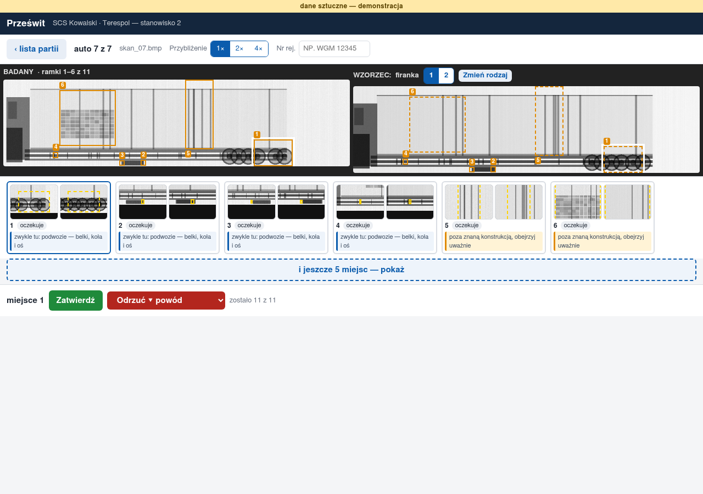
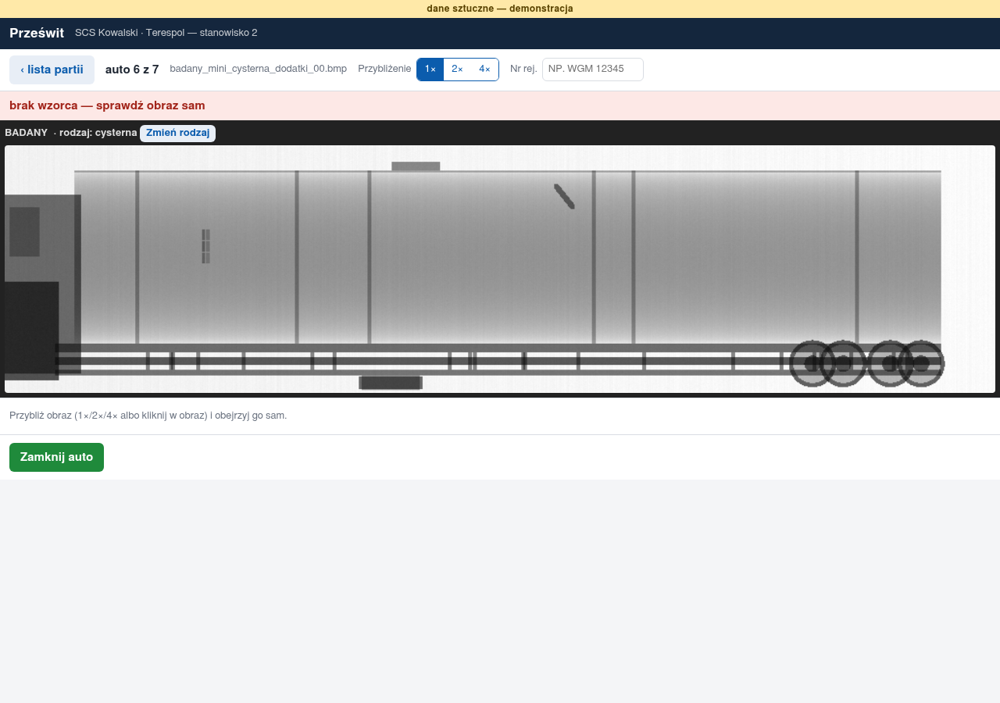

# Slajdy R3 — Prześwit (DRAFT, 10 slajdów; PDF: docs/slajdy.pdf)

> Oś przekazu (`value-prop-statements`): *Dla operatora RTG na granicy: Prześwit wskazuje miejsca, w których obraz naczepy odbiega od wzorca, więc operator w kilka minut wie, gdzie szukać skrytki — decyzję nadal podejmuje on.*
> Wszystkie liczby: dane sztuczne, linie WYNIK w `docs/decyzje.md` (zadania 20 i 33). Zrzuty makiety R3 (część ekranów z R2: logowanie, cysterna).

## 1. Prześwit
- Prześwit to pomocnik operatora RTG: pokazuje, gdzie na obrazie auta patrzeć najpierw, a decyzja zawsze zostaje po stronie człowieka.
- Narzędzie AI dla operatora RTG: porównuje obraz naczepy z wzorcem i zaznacza różnice.
- Zespół: Hackathon · repo: github.com/PawelPisarek/hacknation-proba17
- Wszystko na danych sztucznych — demonstracja.
- 

## 2. Problem
- Operator RTG KAS ogląda obrazy naczep i musi wypatrzyć skrytkę lub dodatkowy ładunek.
- Małe przeróbki konstrukcji łatwo przeoczyć; obecne narzędzie do papierosów słabo radzi sobie z małymi ilościami w konstrukcji.
- Na jedno auto operator ma kilka minut.
- 

## 3. Dla kogo
- Operator RTG Służby Celno-Skarbowej na granicy zewnętrznej UE.
- Zyskuje: wskazane miejsca do kontroli fizycznej zamiast przeglądania całego obrazu „na oko”.
- Obrazy ze skanerów Nuctech i Multicontrol (.bmp, ~50 MB).
- 

## 4. Rozwiązanie
- Program dobiera wzorzec typu pojazdu z biblioteki; operator może zmienić rodzaj, a analiza liczy się od nowa.
- Zaznacza miejsca różne od wzorca, w kolejności od najbardziej odmiennego (bez ocen słownych): najważniejsze to nie przeoczyć; pokazujemy, ile przeoczeń i ile fałszywych alarmów.
- Partia: operator wskazuje kilka obrazów, program liczy je po kolei i oddaje listę aut.
- Gdy nie ma wzorca: nic nie zaznacza i mówi „brak wzorca — obejrzyj ręcznie”.
-   

## 5. Operator decyduje
- Przy każdym miejscu operator zatwierdza albo odrzuca; powód podaje przy odrzuceniu.
- Decyzje, powody, kto i kiedy — w raporcie, zapisanym lokalnie jednym przyciskiem.
- Gdy program nic nie wskazuje: „brak wskazań — to nie gwarancja, że auto jest czyste”.
- 

## 6. Demo (≈ 113 s, `docs/demo.md`)
- Partia 7 aut z `dane/mini`; 7. auto to przypadek trudny (dodatek za ładunkiem), na liście nieoznaczony. U góry pasek „dane sztuczne — demonstracja”.
- Auto 1: rozstrzygamy 2 miejsca i wracamy na listę, reszta „oczekuje”. 
- Auto: obraz i wzorzec obok siebie, kafelki, zatwierdź/odrzuć z powodem. 
- Brak wzorca (cysterna): „obejrzyj ręcznie”. 
- Raport partii; auta bez decyzji — ostrzeżenie i potwierdzenie. 
- Ograniczenie: dodatek za ładunkiem może nie dostać ramki — mówimy to wprost.

## 7. Jak to mierzymy — wyniki na danych sztucznych
- Przeoczenia: 7,8% na zbiorze zwykłym (5/64), 9,7% na trudnym (6/62).
- Ramki na czystym aucie: średnio 5,8 (zwykły) i 6,25 (trudny); fałszywe alarmy (auto z ≥ 1 ramką): 32/32 i 40/40 — dlatego lista ma najwyżej 6 miejsc i „pokaż resztę”.
- Dobór wzorca: 64/64 (zwykły), 80/80 (trudny); cysterny bez wzorca w bibliotece → „brak wzorca” 50/50.
- Czas na obraz ~50 MB: średnio 1,73 s (zwykły), 1,19 s (trudny).
- Źródło: zadania 20 i 33 w `docs/decyzje.md`; to nie są wyniki na obrazach KAS.

## 8. Na tle istniejących rozwiązań
- Porównanie: najpierw skuteczność, potem sposób pokazania operatorowi.
- Dostawcy skanerów (Rapiscan, Smiths Detection, Nuctech, Leidos) mają własne analizy związane z własnym sprzętem; obecne narzędzie KAS wykrywa papierosy.
- Prześwit: porównanie z wzorcem typu, lokalnie, z decyzją operatora; bez porównania z deklaracją.
- Szczegóły i źródła: `docs/pm/01-competitive-analysis.md`.

## 9. Co dalej
- Biblioteka prawdziwych wzorców typów pojazdów po otrzymaniu danych KAS.
- Praca lokalna, bez internetu (wymóg KAS) i integracja z repozytorium obrazów KAS.
- Skalowanie na większe zbiory (kolejka, równoległe liczenie) i wzorce per dostawca skanera.
- Pomiary na obrazach KAS; miniatura w raporcie po MVP.

## 10. Użyte narzędzia
- Zespół botów na OpenMausBot (github.com/milind-soni/OpenMausBot, Apache-2.0).
- Modele Claude (Anthropic).
- Skille pm-skills (github.com/phuryn/pm-skills, MIT).
- Biblioteki z kodu: numpy, torch, pillow (`requirements.txt`).
- Obliczenia: karta graficzna GTX 1050 na komputerze OMEN.

<!-- skill: value-prop-statements -->
