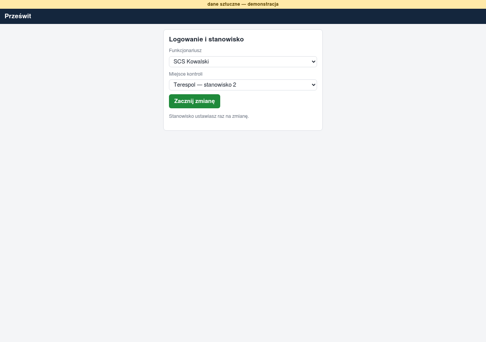
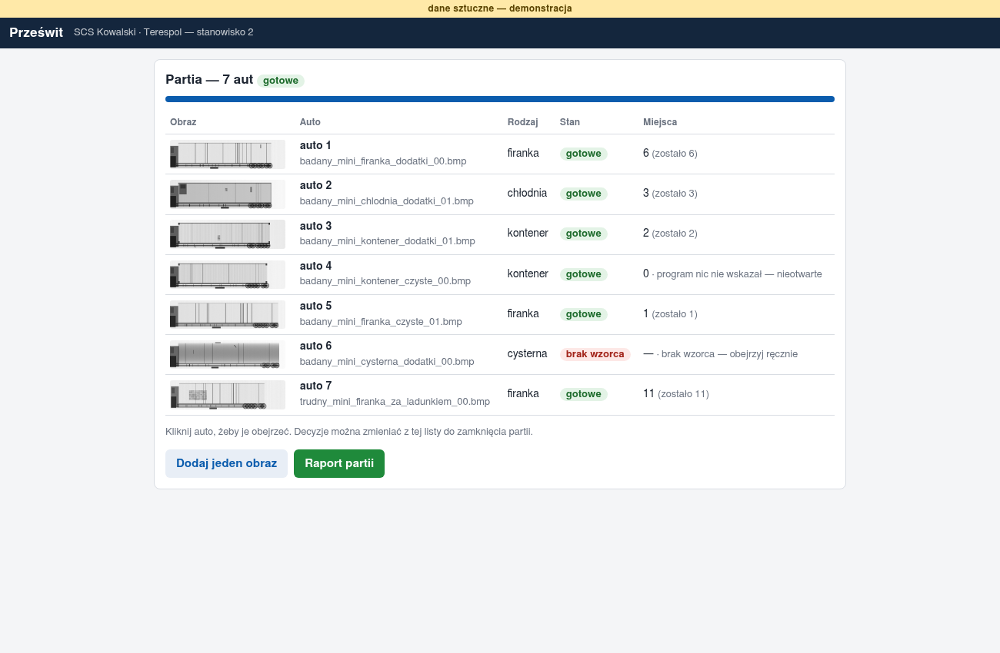
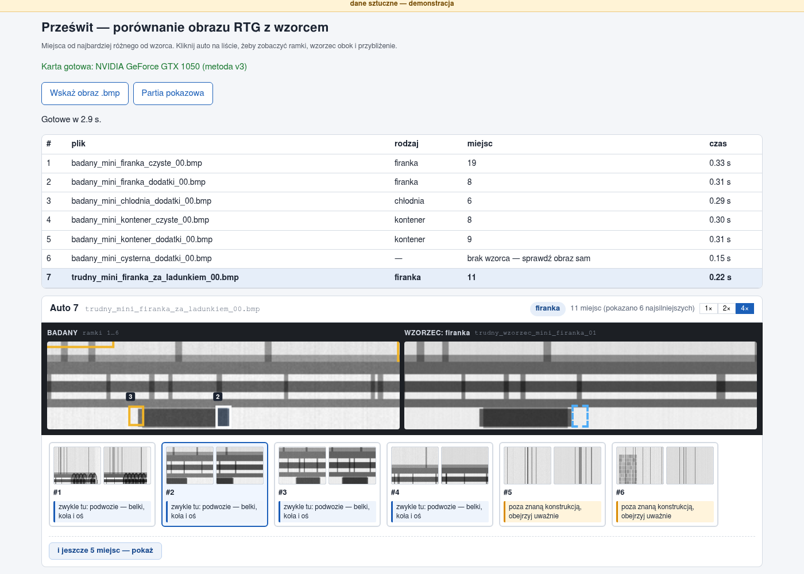

# Slajdy — Prześwit (12 slajdów; PDF: docs/slajdy.pdf)

> Oś przekazu (`value-prop-statements`): *Dla operatora RTG na granicy: Prześwit wskazuje miejsca, w których obraz naczepy odbiega od wzorca, więc operator w kilka minut wie, gdzie szukać skrytki — decyzję nadal podejmuje on.*
> Wszystkie liczby: dane sztuczne, linie WYNIK w `docs/decyzje.md` (zadania 20, 21 i 36), sonda 38 w `docs/odbior.md`. Zrzuty z makiety R3 i z działającego programu.

## 1. Prześwit
- Prześwit to pomocnik operatora RTG: pokazuje, gdzie na obrazie auta patrzeć najpierw, a decyzja zawsze zostaje po stronie człowieka.
- Narzędzie AI dla operatora RTG: porównuje obraz naczepy z wzorcem i zaznacza różnice.
- Zespół: Hackathon · repo: github.com/PawelPisarek/hacknation-proba17
- Makieta: pawelpisarek.github.io/hacknation-proba17/makieta/r3/ · działający program: hacknation.ksefbot.pl
- Wszystko na danych sztucznych — demonstracja.
- 

## 2. Problem
- Operator RTG KAS ogląda obrazy naczep i musi wypatrzyć skrytkę lub dodatkowy ładunek.
- Małe przeróbki konstrukcji łatwo przeoczyć; obecne narzędzie do papierosów słabo radzi sobie z małymi ilościami w konstrukcji.
- Na jedno auto operator ma kilka minut.
- 

## 3. Dla kogo
- Operator RTG Służby Celno-Skarbowej na granicy zewnętrznej UE.
- Zyskuje: wskazane miejsca do kontroli fizycznej zamiast przeglądania całego obrazu „na oko”.
- Obrazy ze skanerów Nuctech i Multicontrol (.bmp, ~50 MB).
- 

## 4. Rozwiązanie
- Program dobiera wzorzec typu pojazdu z biblioteki; operator może zmienić rodzaj, a analiza liczy się od nowa.
- Zaznacza miejsca różne od wzorca, w kolejności od najbardziej odmiennego (bez ocen słownych): najważniejsze to nie przeoczyć; pokazujemy, ile przeoczeń i ile fałszywych alarmów.
- Partia: operator wskazuje kilka obrazów, program liczy je po kolei i oddaje listę aut.
- Gdy nie ma wzorca: nic nie zaznacza i mówi „brak wzorca — sprawdź obraz sam”.
-   

## 5. Operator decyduje
- Przy każdym miejscu operator zatwierdza albo odrzuca; powód podaje przy odrzuceniu.
- Decyzje, powody, kto i kiedy — w raporcie, zapisanym lokalnie jednym przyciskiem.
- Na czystych autach program zwykle coś wskazuje — decyzję zawsze podejmuje człowiek.
- 

## 6. Demo (≈ 114 s, `docs/demo.md`, nagranie na hacknation.ksefbot.pl)
- Partia 7 aut (ramki z wyniku programu): miejsc 8, 6, 12, 8, 7, 0 (brak wzorca), 11; 7. auto (z `dane/mini-trudny`) to przypadek trudny, nieoznaczony na liście.
- Auto 1: rozstrzygamy 2 miejsca i wracamy na listę, reszta „oczekuje”. 
- Auto: obraz i wzorzec obok siebie, kafelki, zatwierdź/odrzuć z powodem. 
- Brak wzorca (cysterna): „sprawdź obraz sam”. 
- Raport partii z miniaturami; auta bez decyzji — ostrzeżenie i potwierdzenie. 
- Ograniczenie: dodatek za ładunkiem może nie dostać ramki — mówimy wprost.

## 7. Jak to mierzymy — wyniki na danych sztucznych
- Przeoczenia: 7,8% na zbiorze zwykłym (5/64), 9,7% na trudnym (6/62).
- Fałszywy alarm = czyste auto z ≥ 1 ramką: 32/32 i 40/40. Nie dajemy alarmu tak/nie, tylko kolejność miejsc (najmocniejsze pierwsze, na ekranie najwyżej 6, reszta pod „pokaż”).
- Miara: ramki na czystym aucie średnio 5,8 (zwykły) i 6,25 (trudny); na 28 czystych autach (sonda 38) zawsze ≥ 2 miejsca — „brak wskazań” nie jest obietnicą.
- Dobór wzorca: 64/64 (zwykły), 80/80 (trudny); 8 z 8 cystern bez wzorca w bibliotece dostaje „brak wzorca — sprawdź obraz sam” i 0 ramek; żadne auto z wzorcem nie dostaje „brak wzorca” (zadanie 36, obecna wersja programu).
- Czas pracy programu na obraz ~50 MB: średnio 1,73 s (zwykły), 1,19 s (trudny); czasu pracy operatora nie mierzyliśmy.
- Źródło: zadania 20 i 36 w `docs/decyzje.md`, `docs/odbior.md`; to nie są wyniki na obrazach KAS.

## 8. Co nowego
- Samodzielny dobór wzorca rodzaju pojazdu: 64/64 i 80/80 (zad. 20).
- Porównanie z dwoma najbliższymi wzorcami po wyrównaniu: przeoczenia 7,8% / 9,7% (zad. 20).
- Ramka + „zwykle tu…” zamiast surowej mapy: średnio 5,8 / 6,25 ramki na czystym aucie.
- Decyzja z powodem odrzucenia w raporcie (.json, .csv, .html z miniaturami) — materiał do douczania.
- Działa lokalnie, bez internetu: partia pokazowa 7/7 w kontenerze bez sieci (zad. 21).
- Zbudowane przez zespół 5 botów AI w czasie hackathonu.
- 

## 9. Skalowanie
- 1 karta (GTX 1050), 50 MB: 1,73 s / 1,19 s na obraz (pomiar, zad. 20) → ok. 2 080 / 3 020 aut/h samego liczenia (wyliczenie 3600 ÷ czas).
- Przez stronę: wysyłka 45 s (pomiar 8768b32), całe żądanie ~52 s → ok. 70 aut/h na stanowisko; przy liczeniu obok skanera wąskie gardło znika.
- Więcej kart i stanowisk: przepustowość rośnie mniej więcej liniowo — założenie, niemierzone.
- Nowy rodzaj pojazdu: dołożenie wzorców do biblioteki, bez trenowania; koszt to zdobycie wzorców.

## 10. Na tle istniejących rozwiązań
- Porównanie: najpierw skuteczność, potem sposób pokazania operatorowi.
- Dostawcy skanerów (Rapiscan, Smiths Detection, Nuctech, Leidos) mają własne analizy związane z własnym sprzętem; obecne narzędzie KAS wykrywa papierosy.
- Prześwit: porównanie z wzorcem typu, lokalnie, z decyzją operatora; bez porównania z deklaracją.
- Szczegóły i źródła: `docs/pm/01-competitive-analysis.md`.

## 11. Co dalej
- Biblioteka prawdziwych wzorców typów pojazdów po otrzymaniu danych KAS.
- Praca lokalna, bez internetu (wymóg KAS) i integracja z repozytorium obrazów KAS.
- Skalowanie na większe zbiory (kolejka, równoległe liczenie) i wzorce per dostawca skanera.
- Pomiary na obrazach KAS.

## 12. Użyte narzędzia
- Zespół botów na OpenMausBot (github.com/milind-soni/OpenMausBot, Apache-2.0).
- Modele Claude (Anthropic).
- Skille pm-skills (github.com/phuryn/pm-skills, MIT).
- Biblioteki z kodu: numpy, torch, pillow (`requirements.txt`).
- Orkiestrator zadań (Slurm); obliczenia: karta graficzna GTX 1050 na komputerze OMEN.

<!-- skill: value-prop-statements -->
