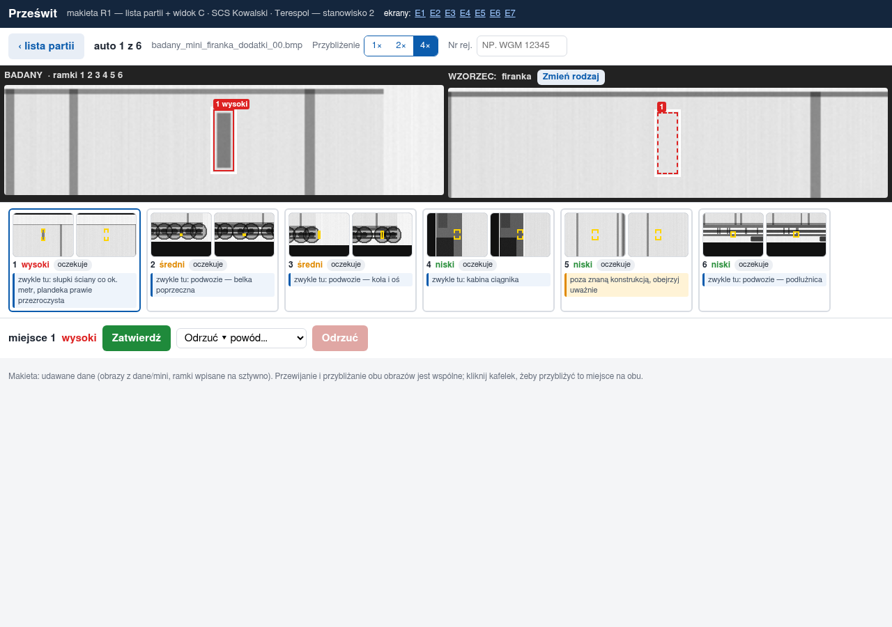
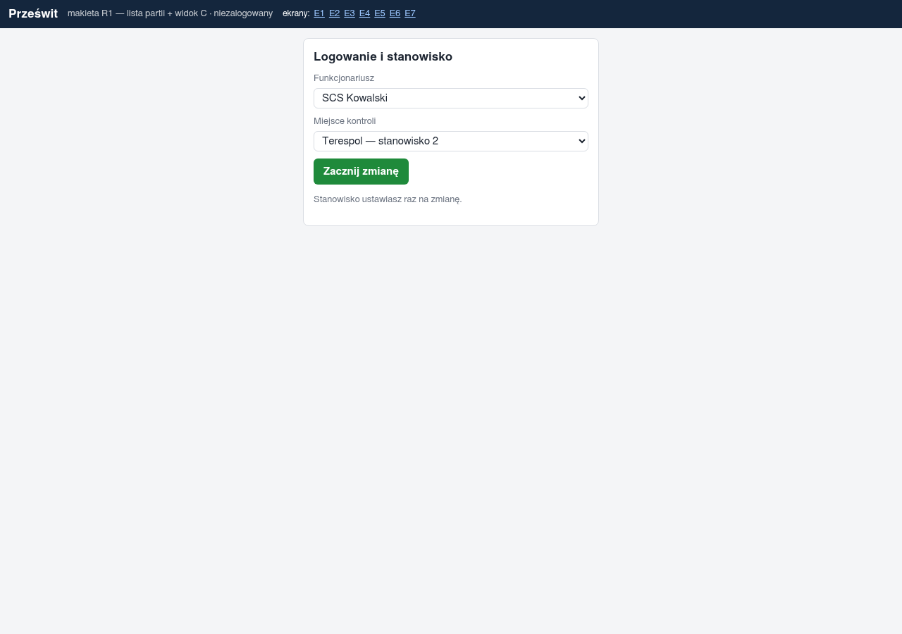
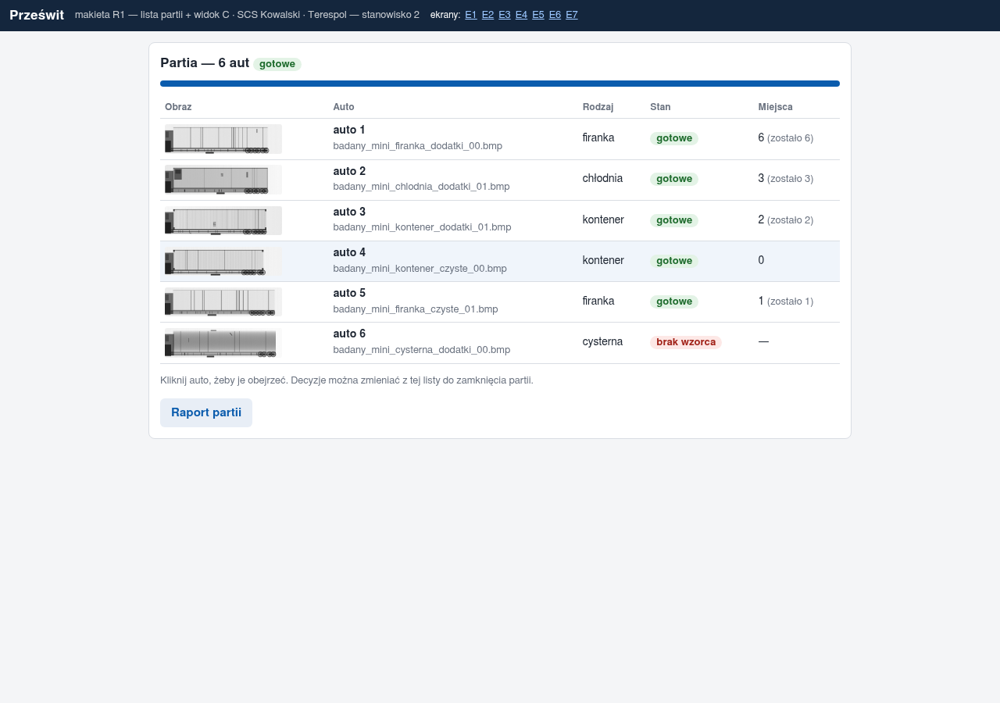
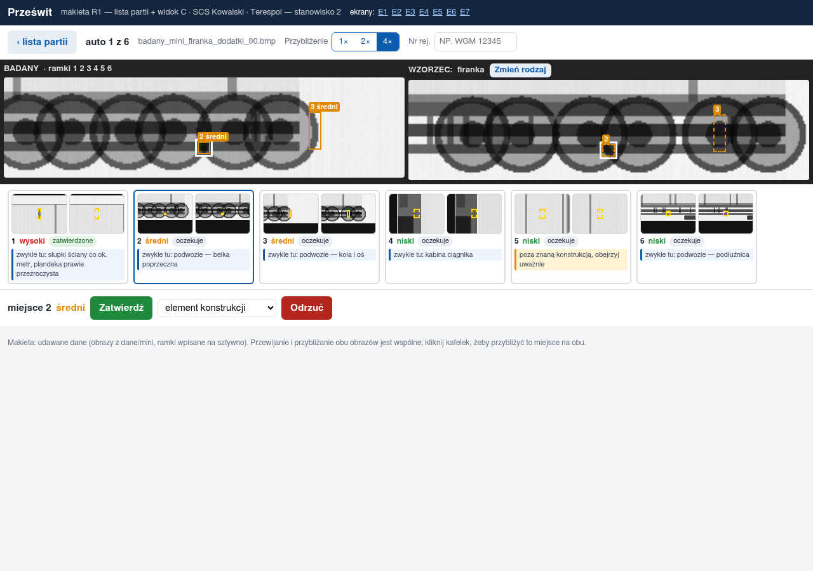
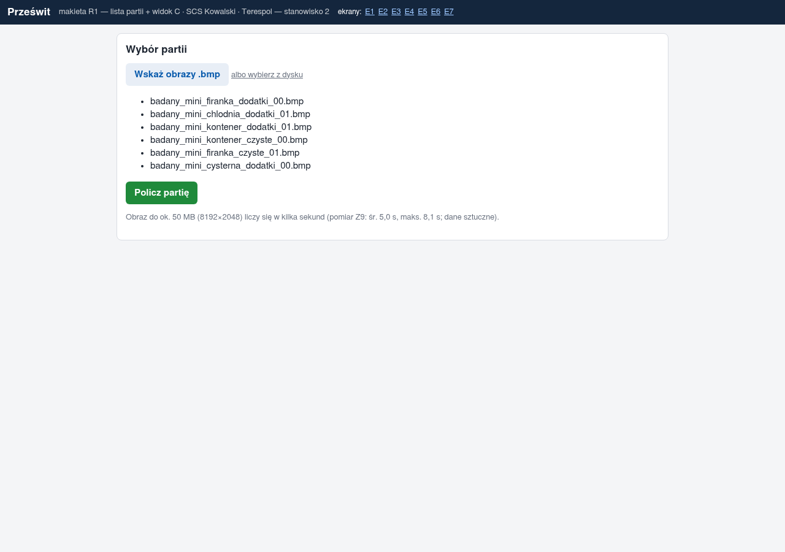
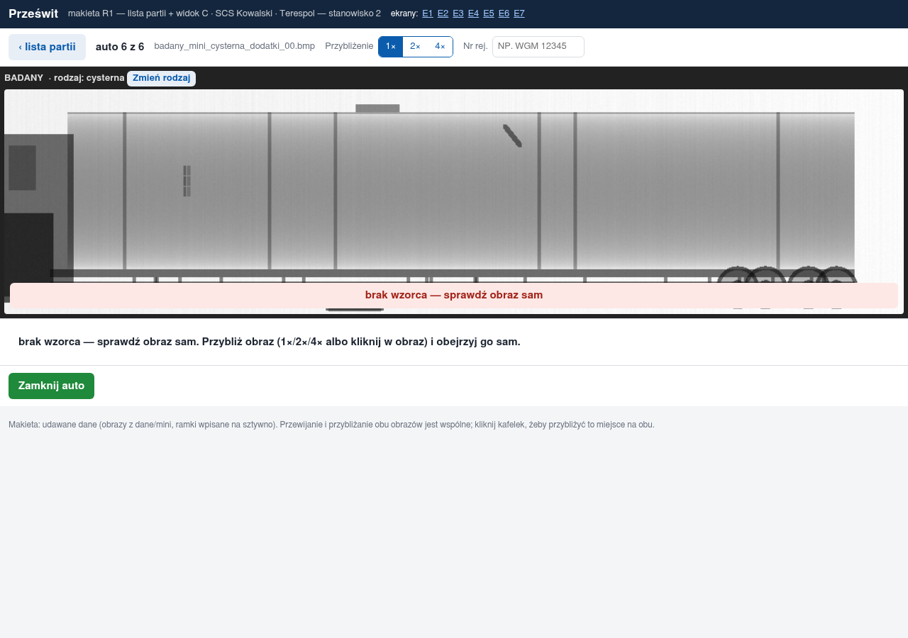
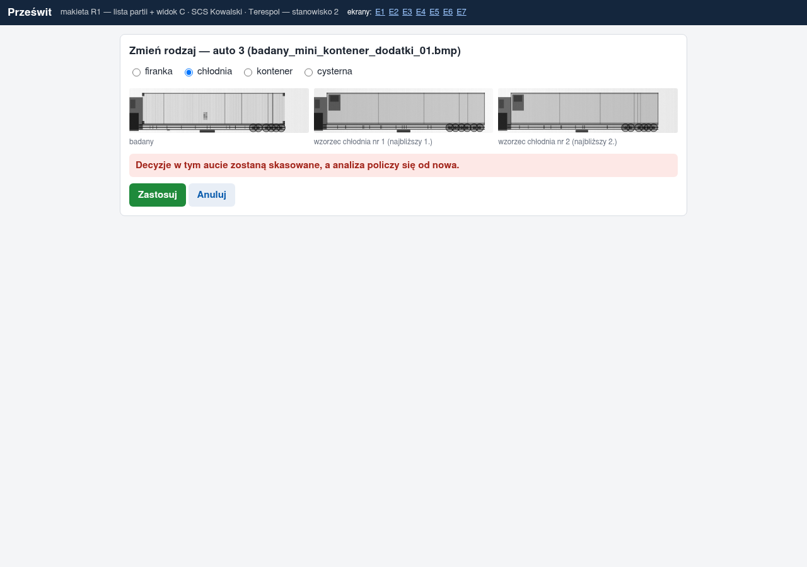
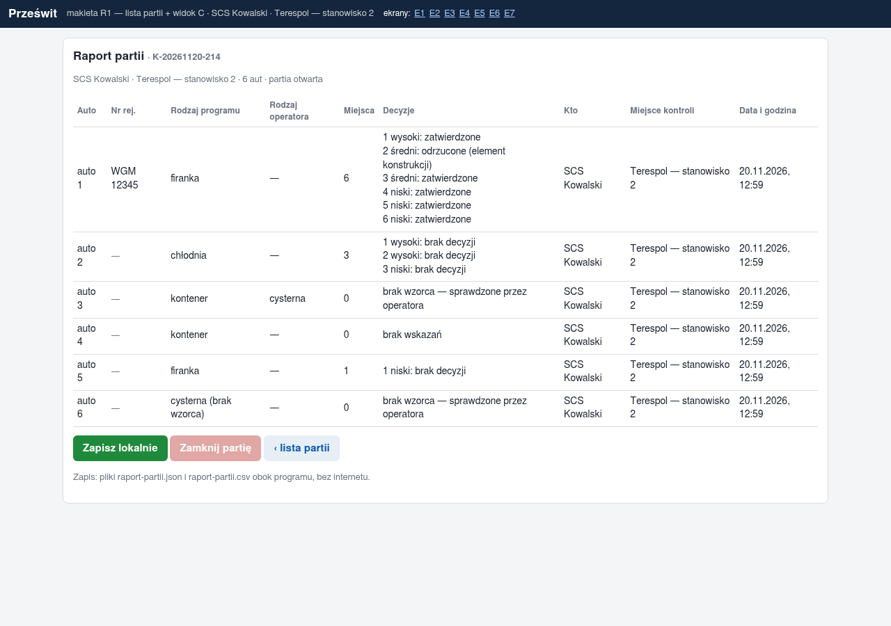

# Slajdy — szkielet (DRAFT, ≤ 10 slajdów, potem PDF)

> Szkic przed pomiarami i makietą. Liczby skuteczności: „—” (nie wpisujemy niczego, czego nie zmierzyliśmy).
> Oś przekazu (`value-prop-statements`): *Dla operatora RTG na granicy: Prześwit wskazuje miejsca, w których obraz naczepy odbiega od wzorca, więc operator w kilka minut wie, gdzie szukać skrytki — decyzję nadal podejmuje on.*
> Nazwa „Prześwit”.

## 1. Prześwit — tytuł
- Narzędzie AI dla operatora RTG: porównuje obraz naczepy z wzorcem i zaznacza różnice.
- Zespół: Hackathon · repo: github.com/PawelPisarek/hacknation-proba17
- 

## 2. Problem
- Operator RTG KAS ogląda obrazy naczep i musi wypatrzyć skrytkę lub dodatkowy ładunek.
- Małe przeróbki konstrukcji (detale, skrytki) łatwo przeoczyć; obecne narzędzie do papierosów słabo radzi sobie z małymi ilościami w konstrukcji.
- Na jedno auto operator ma kilka minut.
- 

## 3. Dla kogo
- Operator RTG Służby Celno-Skarbowej na granicy zewnętrznej UE.
- Zyskuje: wskazane miejsca do kontroli fizycznej, zamiast przeglądania całego obrazu „na oko”.
- Obrazy pochodzą ze skanerów Nuctech i Multicontrol (formaty .bmp, ~50 MB).
- 

## 4. Rozwiązanie
- System sam dobiera wzorzec **typu pojazdu** z biblioteki (operator rzadko ma czyste zdjęcie tej samej naczepy).
- Program dobiera wzorzec typu pojazdu; operator może zmienić rodzaj pojazdu, a analiza liczy się od nowa. Gdy brak wzorca: nic nie zaznacza, napis „brak wzorca — sprawdź obraz sam”.
- Program zaznacza miejsca różnic; najważniejsze: nie przeoczyć; pokazujemy, ile przeoczeń i ile fałszywych alarmów.
- Partie: operator wskazuje kilka obrazów, program liczy je po kolei i oddaje listę wyników.
-   

## 5. Operator decyduje
- Dopiero na wyniku operator przy każdym zaznaczonym miejscu zatwierdza albo odrzuca; przy odrzuceniu podaje powód.
- Decyzje i powody zostają w raporcie.
- Człowiek zostaje decydentem; narzędzie tylko wskazuje, gdzie patrzeć.
- 

## 6. Demo
- Scenariusz ≤ 2 min (`docs/demo.md`); makieta R1: https://pawelpisarek.github.io/hacknation-proba17/makieta/r1/ (wersja na ksefbot.pl — wpisać po wdrożeniu). Dane: własny, sztuczny zbiór.
- Wybór partii: operator wskazuje kilka obrazów .bmp i uruchamia liczenie. 
- Lista partii: auta liczą się po kolei, wejście w auto po policzeniu całej partii. 
- Auto: obraz badany i wzorzec obok siebie, miejsca jako kafelki, zatwierdzenie albo odrzucenie z powodem. 
- Brak wzorca: program niczego nie zaznacza i mówi „sprawdź obraz sam”. 
- Zmiana rodzaju pojazdu: analiza liczy się od nowa. 
- Raport partii: decyzje z powodami, zapis lokalnie. 
- Ograniczenie (P52 A): dodatek za ładunkiem może nie dostać ramki — mówimy to wprost, operator ogląda obraz sam.

## 7. Jak to działa i jak to mierzymy
- Dane: sztuczne naczepy „czyste” i z „dodatkowym ładunkiem”; duże pliki .bmp (~50 MB) i partie obrazów (lista wyników) działają już w pierwszej wersji.
- Priorytet: przeoczenie jest gorsze niż fałszywy alarm — ale liczbę fałszywych alarmów pokazujemy wprost.
- Przeoczenia (na obrazach z dodatkami): — · fałszywe alarmy (na obrazach czystych): — · czas na obraz: —
- [zrzut: wykres/tabela wyniku na zbiorze testowym — po pomiarze]

## 8. Narzędzia przygotowane wcześniej
- Zespół botów na OpenMausBot (github.com/milind-soni/OpenMausBot, Apache-2.0).
- Modele Claude (Anthropic).
- Skille pm-skills (github.com/phuryn/pm-skills, MIT).
- Biblioteki z kodu: [dopisać po powstaniu kodu].

## 9. Na tle istniejących rozwiązań
- Porównanie: przede wszystkim skuteczność (czy wskazuje to, co ukryte), na drugim miejscu sposób pokazania operatorowi.
- Konkurenci: oprogramowanie producentów skanerów oraz obecne narzędzie KAS do papierosów.
- [zrzut: tabela porównania z docs/pm/01-competitive-analysis.md — po poprawce recenzji]

## 10. Co dalej
- Zasilić biblioteką prawdziwych wzorców typów pojazdów po otrzymaniu danych KAS.
- Docelowo praca lokalna, bez internetu i chmury (wymóg KAS) oraz integracja z repozytorium obrazów KAS.
- Rozbudowa skalowania na większe zbiory oraz wzorce per dostawca skanera (Nuctech, Multicontrol); pomiary na obrazach KAS —.
- [zrzut: schemat wdrożenia — opcjonalnie]

<!-- skill: value-prop-statements -->
