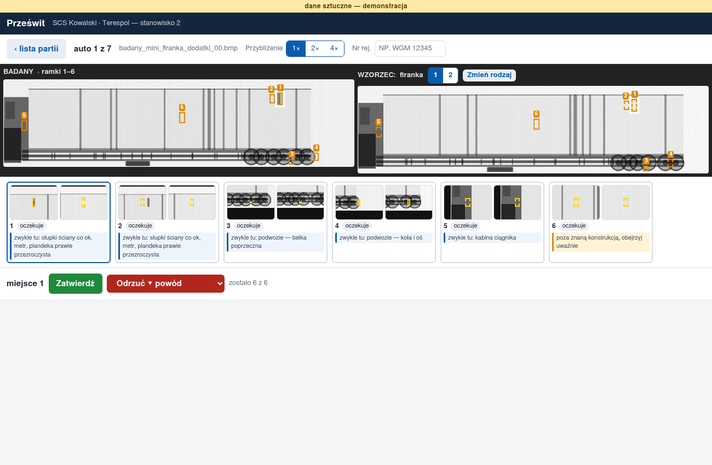
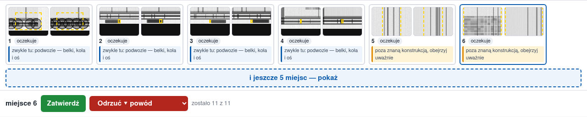
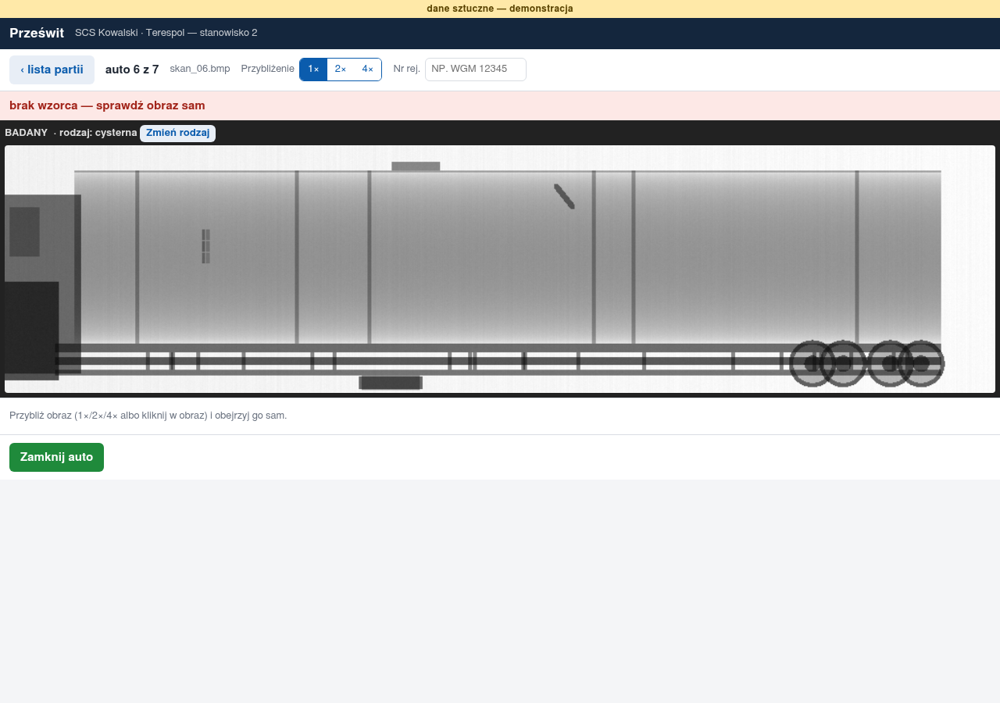
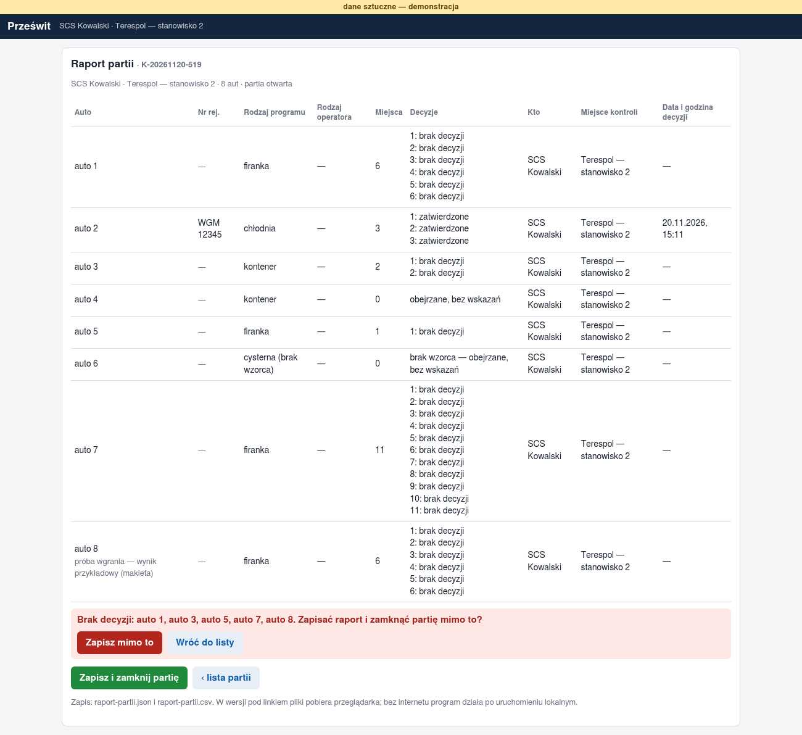

# Slajdy — Prześwit (10 slajdów; PDF: docs/slajdy.pdf)

> Oś przekazu (`value-prop-statements`): *Dla operatora RTG na granicy: Prześwit wskazuje miejsca, w których obraz naczepy odbiega od wzorca, więc operator w kilka minut wie, gdzie szukać skrytki — decyzję nadal podejmuje on.*
> Wszystkie liczby: dane sztuczne, linie WYNIK w `docs/decyzje.md` (zadania 20, 21 i 36), sonda 38 w `docs/odbior.md`. Zrzuty z makiety R3 i z działającego programu.

## 1. Prześwit
- Prześwit to pomocnik operatora RTG: pokazuje, gdzie na obrazie auta patrzeć najpierw, a decyzja zawsze zostaje po stronie człowieka.
- Narzędzie AI dla operatora RTG: porównuje obraz naczepy z wzorcem i zaznacza różnice.
- Zespół: Hackathon · repo: github.com/PawelPisarek/hacknation-proba17
- Makieta: pawelpisarek.github.io/hacknation-proba17/makieta/r3/ · działający program: hacknation.ksefbot.pl
- Wszystko na danych sztucznych — demonstracja.
- 

## 2. Problem i dla kogo
- Operator RTG Służby Celno-Skarbowej na granicy UE ogląda obrazy naczep (Nuctech, Multicontrol; .bmp, ~50 MB) i musi wypatrzyć skrytkę lub dodatkowy ładunek — na jedno auto ma kilka minut.
- Małe przeróbki konstrukcji łatwo przeoczyć; obecne narzędzie KAS wykrywa papierosy, słabo radzi sobie z małymi ilościami w konstrukcji.
- Zyskuje: wskazane miejsca do kontroli fizycznej zamiast przeglądania całego obrazu „na oko”.
- 

## 3. Rozwiązanie
- Program dobiera wzorzec typu pojazdu z biblioteki; operator może zmienić rodzaj, a analiza liczy się od nowa.
- Zaznacza miejsca różne od wzorca, w kolejności od najbardziej odmiennego (bez ocen słownych): najważniejsze to nie przeoczyć; pokazujemy, ile przeoczeń i ile fałszywych alarmów.
- Partia: operator wskazuje kilka obrazów, program liczy je po kolei i oddaje listę aut.
- Gdy nie ma wzorca: nic nie zaznacza i mówi „brak wzorca — sprawdź obraz sam”.
-   

## 4. Operator decyduje
- Przy każdym miejscu operator zatwierdza albo odrzuca; powód podaje przy odrzuceniu.
- Decyzje, powody, kto i kiedy — w raporcie, zapisanym lokalnie jednym przyciskiem.
- Na czystych autach program zwykle coś wskazuje — decyzję zawsze podejmuje człowiek.
- 

## 5. Demo (≈ 114 s, `docs/demo.md`, nagranie na hacknation.ksefbot.pl)
- Partia 7 aut (ramki z wyniku programu): miejsc 8, 6, 12, 8, 7, 0 (brak wzorca), 11; 7. auto (z `dane/mini-trudny`) to przypadek trudny, nieoznaczony na liście.
- Auto 1: rozstrzygamy 2 miejsca i wracamy na listę, reszta „oczekuje”. 
- Auto: obraz i wzorzec obok siebie, kafelki, zatwierdź/odrzuć z powodem. 
- Brak wzorca (cysterna): „sprawdź obraz sam”. 
- Raport partii z miniaturami; auta bez decyzji — ostrzeżenie i potwierdzenie. 
- Ograniczenie: dodatek za ładunkiem może nie dostać ramki — mówimy wprost.

## 6. Wyniki na danych sztucznych — przed i po
- Przed: obraz bez ramek; po: ten sam z 6 najmocniejszymi miejscami (auto 7).
- Przeoczenia: 7,8% (5/64) i 9,7% (6/62); dobór wzorca 64/64 i 80/80.
- Fałszywy alarm = czyste auto z ≥ 1 ramką (32/32, 40/40): dajemy kolejność miejsc, nie alarm tak/nie; ramki na czystym śr. 5,8 / 6,25.
- Cysterna bez wzorca: „sprawdź obraz sam”, 0 ramek (8/8). Czas 50 MB: śr. 1,73 s / 1,19 s.
- Źródło: zad. 20 i 36; dane sztuczne, nie KAS.
- 

## 7. Co nowego
- Samodzielny dobór wzorca rodzaju pojazdu: 64/64 i 80/80 (zad. 20).
- Porównanie z dwoma najbliższymi wzorcami po wyrównaniu: przeoczenia 7,8% / 9,7% (zad. 20).
- Ramka + „zwykle tu…” zamiast surowej mapy: średnio 5,8 / 6,25 ramki na czystym aucie.
- Decyzja z powodem odrzucenia w raporcie (.json, .csv, .html z miniaturami) — materiał do douczania.
- Działa lokalnie, bez internetu: partia pokazowa 7/7 w kontenerze bez sieci (zad. 21).
- Zbudowane przez zespół 5 botów AI w 24 h.

## 8. Skalowanie (pomiary i założenia)
- 1 karta GTX 1050, obraz 50 MB: 1,73 s / 1,19 s (pomiar, zad. 20) → ok. 2 080 / 3 020 aut/h — wyliczenie 3600 ÷ czas, bez wczytania pliku.
- Przez stronę: wysyłka 45 s (pomiar 8768b32), całe żądanie ~52 s (jeden pomiar, zad. 21, inny przebieg) → rząd wielkości ok. 70 aut/h na stanowisko, nie wynik.
- Założenia, niemierzone: więcej kart i stanowisk → przepustowość mniej więcej liniowo; liczenie obok skanera usuwa wąskie gardło wysyłki; nowy rodzaj pojazdu = dołożenie wzorców bez trenowania (próg doboru mógłby wymagać strojenia).

## 9. Na tle istniejących rozwiązań
- Porównanie: najpierw skuteczność, potem sposób pokazania operatorowi.
- Dostawcy skanerów (Rapiscan, Smiths Detection, Nuctech, Leidos) mają własne analizy związane z własnym sprzętem; obecne narzędzie KAS wykrywa papierosy.
- Prześwit: porównanie z wzorcem typu, lokalnie, z decyzją operatora; bez porównania z deklaracją.
- Szczegóły i źródła: `docs/pm/01-competitive-analysis.md`.

## 10. Co dalej i użyte narzędzia
- Dalej: wzorce z prawdziwych danych KAS i pomiary na obrazach KAS; integracja z repozytorium obrazów i systemami KAS; wzorce per dostawca skanera; pomiar skalowania na kilku kartach.
- Narzędzia: zespół botów na OpenMausBot (github.com/milind-soni/OpenMausBot, Apache-2.0), modele Claude (Anthropic), skille pm-skills (github.com/phuryn/pm-skills, MIT).
- Z kodu: numpy, torch, pillow; orkiestrator zadań (Slurm); karta GTX 1050 w komputerze OMEN.

<!-- skill: value-prop-statements -->
